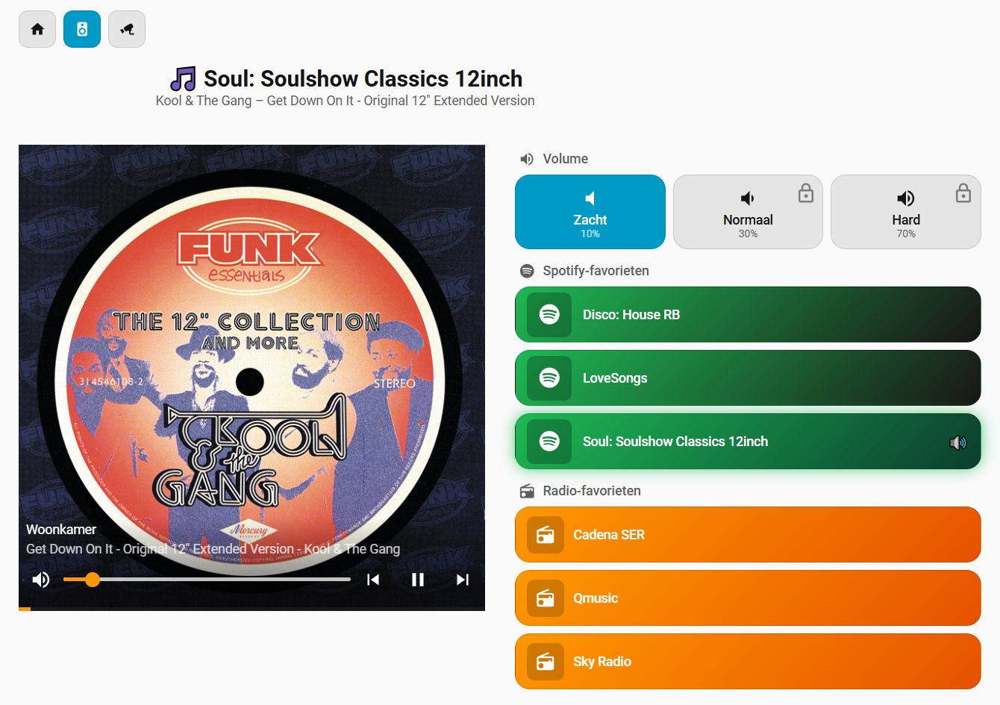
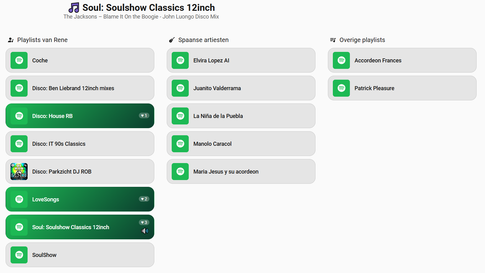
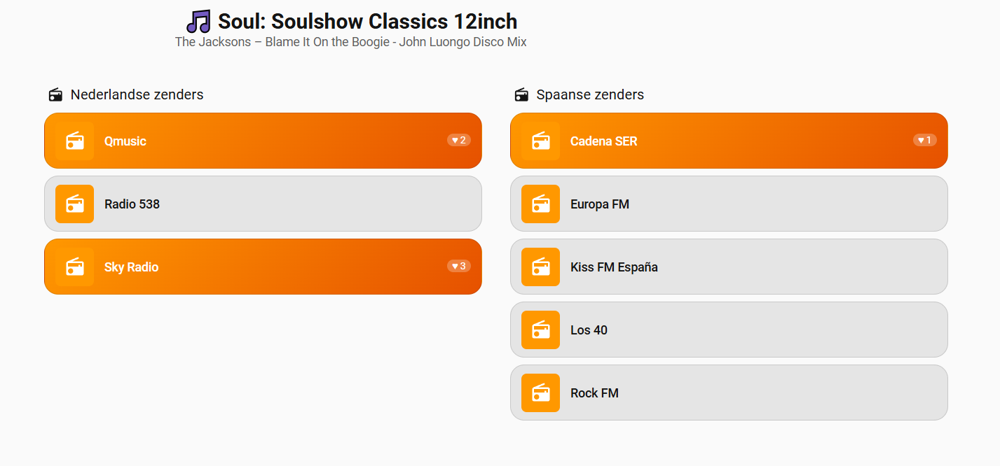

# Groovy Sonos Dashboard for Home Assistant

A clean, phone-friendly media dashboard for a Sonos speaker, with **Spotify playlists** and **internet radio** driven by two simple JSON files. Pick your favorites with a long-press, see at a glance what is playing, and keep the neighbours happy with volume presets that lock at night.



| Spotify library | Radio library |
|---|---|
|  |  |

<!-- Add a phone screenshot here later:  -->

## Features

- **Now playing header** showing the radio station or Spotify playlist name, plus artist and title.
- **Big player** with full-cover artwork (mini-media-player).
- **Volume presets** (Low / Normal / Loud). The active preset lights up, and Normal/Loud can lock themselves at night.
- **3 Spotify + 3 radio favorites** as tiles with cover art or logos. A 🔊 and a glow show what is playing.
- **Libraries from JSON**: add a playlist or station by editing a JSON file. No dashboard edits needed.
- **Long-press any playlist or station** to make it favorite 1. The others shift down.
- Works in **light and dark themes**, on desktop and phone (sections view).
- **Debug mode**: switch on `input_boolean.sonos_dashboard_debug` and every action is written to the logbook.

## Requirements

- Home Assistant 2024.10 or newer (sections view, `action:` syntax)
- The [Sonos integration](https://www.home-assistant.io/integrations/sonos/), with Spotify linked to your Sonos system in the Sonos app
- From HACS (Frontend):
  - [button-card](https://github.com/custom-cards/button-card) v4.2 or newer
  - [mini-media-player](https://github.com/kalkih/mini-media-player)
  - [auto-entities](https://github.com/thomasloven/lovelace-auto-entities)

## Installation

### 1. Backend (helpers, sensors and scripts)

1. Enable packages in `configuration.yaml` if you have not already:
   ```yaml
   homeassistant:
     packages: !include_dir_named packages
   ```
2. Copy `packages/sonos_dashboard.yaml` to `/config/packages/`.
3. Copy the folder `www/sonos-dashboard/` to `/config/www/sonos-dashboard/`.
4. Restart Home Assistant.

You should now have `sensor.media_library`, `sensor.radio_stations`, the `input_text.spotify_fav_*` / `radio_fav_*` helpers and the scripts `play_spotify`, `play_radio` and `set_media_favorite`.

> **HTTPS only?** The REST sensors read the JSON from `http://localhost:8123/local/...`. If your instance does not listen on plain HTTP locally, change the `resource:` lines to your own URL.

### 2. Dashboard

1. Create a new dashboard (Settings > Dashboards > Add dashboard > New dashboard from scratch).
2. Open it, click the pencil, then the three dots > **Raw configuration editor**.
3. Paste the contents of `dashboard/sonos-dashboard.yaml`.
4. **Replace `media_player.YOUR_SONOS`** with your own Sonos entity. It appears in exactly two places: the `sonos_player` template at the top and the mini-media-player card.
5. Save.

The navigation buttons work whatever you call your dashboard.

## Your own playlists and stations

### `www/sonos-dashboard/media_library.json`

```json
{
  "items": [
    { "name": "Rock Classics", "url": "spotify:playlist:37i9dQZF1DWXRqgorJj26U", "category": "mine", "img": "" }
  ]
}
```

| Field      | Meaning |
|------------|---------|
| `name`     | Name on the tile |
| `url`      | Spotify URI (`spotify:playlist:...`, `spotify:album:...`). In Spotify: Share > Copy link, then turn `open.spotify.com/playlist/ID` into `spotify:playlist:ID` |
| `category` | Which section it appears in: `mine`, `artists`, or anything else for "Other playlists" |
| `img`      | Optional cover image URL. Leave empty to show the Spotify icon |

### `www/sonos-dashboard/radio_stations.json`

```json
{
  "stations": [
    { "name": "Radio 538", "url": "http://stream.radio538.nl/538", "group": "local", "logo": "" }
  ]
}
```

| Field   | Meaning |
|---------|---------|
| `name`  | Name on the tile |
| `url`   | Direct stream URL (mp3/aac). [radio-browser.info](https://www.radio-browser.info) is a good place to find them |
| `group` | `local` goes to "Local stations", anything else to "International" |
| `logo`  | Optional logo URL. Leave empty to show a radio icon |

The sensors refresh every hour. To see changes right away, go to Developer tools > Actions and run `homeassistant.update_entity` on `sensor.media_library` or `sensor.radio_stations`.

Want more sections? Copy a section in the dashboard YAML and change the filter (for example `p.category | default('') == 'jazz'`).

## Customising

| What | Where |
|------|-------|
| Volume levels and lock hours | `variables:` on the three `volume_button` cards |
| Colours of the favorites | `background:` in the `spotify_favorite` / `radio_favorite` templates |
| Debug output to your phone or Telegram | Replace `logbook.log` in `script.sonos_dashboard_debug` with your notify action |

## Troubleshooting

- **Buttons do nothing**: update button-card to v4.2 or newer (needed for `perform-action`).
- **Spotify does not play**: make sure Spotify is added as a service in the Sonos app, and that you are logged in.
- **🔊 never shows for radio**: some streams redirect to another URL. Use the final stream URL in your JSON.
- **Library is empty**: check that the JSON opens in your browser at `http://<your-ha>:8123/local/sonos-dashboard/media_library.json`, and that it is valid JSON.

## License

MIT, see [LICENSE](LICENSE).
